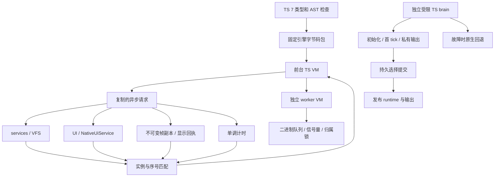

> 历史记录：路径、命令和包后缀对应拆分前的团子 OS 工作区。当前入口见 [EmbedTS 架构](../architecture.md)。

# TS 与 Lua 应用能力对齐

## 运行边界

固件在 Lua 与 TS 中选择一个引擎，默认 Lua。TS 使用固定 tsrs v0.20.1（TypeScript 7.1 beta）、
Rolldown 1.2.16 和 QuickJS-NG 主机编译器生成 `.rsts`；设备关闭源码解析。主机测试允许
同时链接两个引擎以执行差分，固件的 normal 依赖和 ELF 必须只包含所选 VM。

同步宿主操作只读快照或执行有界计算。存储、图像/字体文件和 LVGL 请求复制参数后
交给对应任务。每个完成编号包含实例代次，旧回执不能进入下一实例。停止等待已开始
的 VFS 工作结束，释放 worker、显示和输出，再销毁 VM。



## 能力矩阵

基线来自现有 Lua 模块、前台任务和常驻行为。Lua 语言源码兼容、协程语法与 C API
由 TS 的 async/await 和有类型模块替代。相机、音频及网络支持范围继续以原宿主已有的
快照与控制为准，缺少的模块不会被 capabilities 误报成可用。

| 能力 | TS 实现 | 主机证据 |
| --- | --- | --- |
| 工具链 | tsrs 语义与原始 AST 检查、工作区/相对模块、字节码兼容标识 | 44 项 checker；单模块输出与重复构建一致性 |
| 生命周期 | main/onTick、Promise、不可捕获 OOM/预算、取消与过期回执 | 16 项 runtime；关闭 used=0 |
| 系统 | 时间/date、uptime、堆与 capabilities、参数 schema、周期等待 | SDK 与真实宿主集成 |
| 服务 | audio/camera/network 状态、音量/静音、supported/available 区分 | 原共享服务快照/控制断言 |
| 硬件 | Imu、FuelGauge、Magnetometer 校准、11 种按钮事件、LED/Haptic | 句柄、重复租约、回调异常、代次和校准边界 |
| framebuffer | 图形、字体、文本、bitmap、clip/translate、双缓冲、touch | 精确 RGB565 字节、脏矩形、发布回执与独立副本 |
| 图像 | JPEG/PNG、格式转换、nearest/bilinear、JPEG 保存 | PNG alpha、JPEG 往返、无效数据/尺寸/句柄、真实 VFS |
| 原生 UI | 完整现有 NativeUiService 操作、事件与重绘边界 | TS7→bytecode→真实 LVGL/LittleFS |
| worker | 独立 VM、名称/互斥组/替换、停止/超时、二进制同步 | 4 项组合场景覆盖隔离、锁释放、容量和历史预算 |
| 常驻行为 | TS Affect/Personality、受限输出、持久选择和事务替换 | Lua 差分；候选失败/提交失败/后续故障 |
| 正式应用 | snake、2048、dino、flappy、photo | 游戏规则/碰撞/重置、绘制循环、相册导航与确认删除 |
| 应用交付 | 按引擎生成应用树，app-pack bundle/system，原安装事务 | 完整生成应用集和注册校验 |

## 资源与生命周期

设备前台 VM 为 4 MiB / 20 ms / 200 次中断轮询；crate 主机默认 2 MiB / 4 ms / 100 次。
执行时钟排除其他 RTOS 线程占用；原生绘制仍计入本次采样窗口。正式游戏将较重绘制
拆为主动让出的阶段，`present` 前的中间状态不会发布。worker 为独立 1 MiB VM，最多 8 个活动
实例。brain 为独立 512 KiB，回调预算 20 ms。普通服务失败可捕获，OOM 与解释执行
预算耗尽终止实例。原生 intrinsic 和 C 宿主计算在返回解释器检查点前不能被任意抢占。

图像格式上限为 4 MiB 文件、1920×1080 像素；原生图形配额、解码暂存和 JS 账本
分别检查。PNG 解压/颜色转换需要额外空间，因此格式尺寸上限不等于任意 VM 预算下
都能解码的尺寸。JPEG 编码回调使用可失败 reserve 与明确输出配额。图像/字体文件
字节在宿主保留，JS 回执只携带句柄；普通 storage.read 保留复制传输预算。

图像、字体与显示关闭幂等，已关闭数字句柄不得复用。帧发布保留不可变 Arc 数据，
停止和旧回执不会释放显示任务仍在使用的像素。UI 树、事件和文件图像复用现有的
对象/像素配额与 RedrawBoundary。

TS 常驻选择存放在 `/data/brain/active.rsts.hex`，与 Lua 选择分开。`brain-push`
将 `.rsts` 编成 `rsts1:` envelope，复用阶段文件、CRC、原子 rename 和 UI 提交回执。
候选失败不提交持久选择，提交失败保留旧实例和输出。`brain-default` 事务恢复内置
TS 行为；脚本回调故障后使用已经接收同一批输入的原生行为。
内部传感器输入直接编码 enum/scalar JSON，避免逐事件分配和复制 Value 树；公开 JSON
入口继续验证。TS 常驻回调按实测同步成本请求性能频率，回调结束释放请求。

## 验证入口

```sh
pnpm install --frozen-lockfile --ignore-scripts
pnpm typecheck
pnpm check:apps
./scripts/check.sh
python3 scripts/build_apps.py target/apps-ts --engine ts
cargo run -p app-pack --offline -- bundles target/apps-ts target/bundles-ts
cargo test -p os --no-default-features --features ts-engine --test ts_graphics --test ts_official --offline
```

当前 Rust 工具链完整检查日志在 `target/ts-toolchain-refactor/checks.log`，双固件 ELF、符号隔离与预算在
`target/engine-checks/`。模拟板级快照与输出、主机渲染和交叉链接不能代替设备执行。
设备日志、包指纹、OTA 槽状态和最终显示平面截图单独保存在 `target/ts-parity/`。
工具链迁移及应用工作区的独立验证见 [TS 工具链与工作区](ts-toolchain-workspace.md)。

## 2026-11-03 实体验收记录

ESP-Mosaico S31 v1.2 已执行 SDK 探针、五个官方 TS 应用、实际 JPEG 相册文件
导航/取消/确认删除、brain 拒绝/重启持久化/异常回退，以及十轮启停和一次运行中
更新。实体手指操作记录 12 次 UI 点击和两次 GPIO7 短按；应用自动交互另标为注入。
各完成实例关闭账本 used=0。

该轮设备使用普通 TS 固件：槽 0、seq131、Valid，启动健康位全部通过，内置 TS
brain `error=0`。该固件重新通过 SDK 探针和五个应用烟测，生产资源门禁通过。
诊断固件的额外代码超过生产增量预算，保留失败记录；设备已切回普通配置。

完整范围、证据路径、固件指纹、传感器和输出限制见
[实体设备验收](ts-engine-device-validation.md)，机器回执为
`target/ts-parity/device-results.json`。振动触感尚待操作者回报，LED 扩展板未接入；
Home 的 sensor-drain 告警和 TS brain 开销仍有后续性能工作，不能据此宣称功耗、
最坏延迟或长期稳定性已经追平 Lua。

2026-11-04 的 tsrs 迁移构建和检查单独记录；该历史设备结果对应迁移前的字节码。
归档 ELF 位于 `target/ts-parity/pre-tsrs-engine-checks/`，其原始 SHA-256 保留在
设备回执中。
