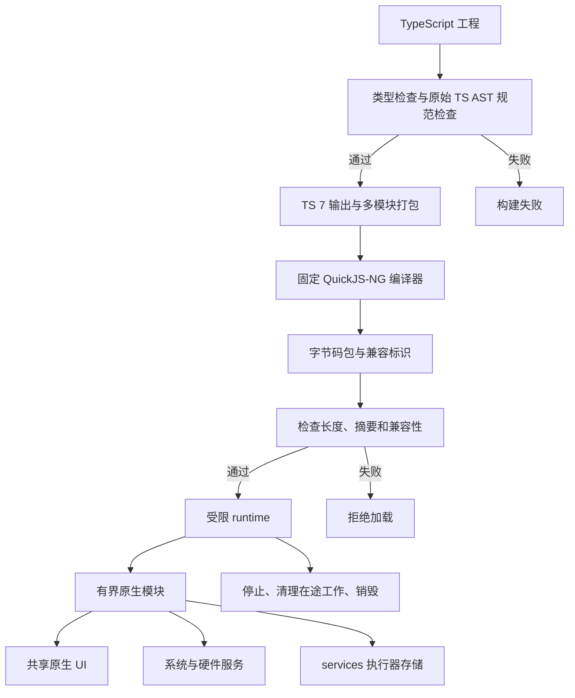

> 历史记录：路径、命令和包后缀对应拆分前的团子 OS 工作区。当前入口见 [EmbedTS 架构](../architecture.md)。

# dangoOS TS 引擎实施设计

状态：工具链、前台宿主、图像/画布、worker、常驻 brain 和五个正式应用已有 TS 实现。
主机使用 tsrs 0.20.1（TypeScript 7.1 beta），设备使用
固定 QuickJS-NG 执行字节码。前台 UI、存储、系统和服务已接入；完整功能与证据
分别记录在 [对齐矩阵](ts-engine-parity.md) 和 `target/engine-checks/`。
ESP-Mosaico S31 实体板已执行 SDK 探针、五个应用、真实相册文件操作和 brain
事务测试；具体固件指纹、范围与限制由 [设备验收记录](ts-engine-device-validation.md)
维护。

## 运行模型

dangoOS 的一个固件选择一个脚本引擎。`lua-engine` 与 `ts-engine` 是互斥的 OS
Cargo features，默认选择 Lua；TS 固件使用 `--no-default-features` 显式选择 TS。
同时选择或均未选择时构建失败。TS 固件的依赖图和链接产物均不得包含 Lua VM。
工作区中的主机工具、测试和另一种固件可以独立构建另一引擎。

`crates/ts-engine` 提供 `no_std + alloc` 的 QuickJS-NG 字节码执行器。主机编译器与
设备执行器使用同一份固定引擎源码和字节码配置。设备关闭 JS 源码解析，不接受 TS
或 JS 源码。TS 是主机侧开发语言，运行时执行 JavaScript 字节码。

脚本通过原生模块访问有界宿主接口。系统服务继续控制硬件，LVGL 操作继续在 UI
任务执行。跨任务消息使用复制的数据和宿主管理的句柄，禁止传递 `JSValue` 或
裸 LVGL 指针。每个 runtime 在同一执行线程创建、调用和销毁。

## 组件边界

| 组件 | 职责 |
| --- | --- |
| `crates/ts-engine` | 引擎构建、字节码包、runtime、执行预算、原生调用和销毁 |
| `crates/app-host` | 硬件快照、服务数据、UI 请求/回执及共用图像编解码；不链接 VM |
| OS 引擎选择层 | 选择前台任务、启动健康检查、应用入口格式和常驻行为实现 |
| 主机工具 | 类型检查、规范检查、转译、字节码编译与打包；源码编译不能进入设备依赖 |
| UI 与硬件服务 | 资源配额、执行请求、停止回执和最终资源清理 |

JPEG 编解码、硬件数据和堆指标从 `lua-engine` 提取到 `app-host`，TS 固件复用它们
而不引入 Lua。Lua 原有公开接口重导出共用类型；Lua 图像解码适配器保留工作缓冲区记账。

## 主机编译与包边界

原始 TS 在类型擦除前完成语义类型检查和子集检查。转译器不代替类型检查器。
tsrs v0.20.1 的 Rust 编译会话（TypeScript 7.1 beta）提供语义、AST 查询与 JavaScript 输出，
Rolldown 1.2.16 合并输出及可信 SDK。支持声明的工作区包与相对 TS 模块，传递导入的应用源文件均需
遵守相同规则。动态代码生成、动态导入、类型检查逃逸和对象形状修改入口由构建规则
拒绝。工作区以外的 npm 应用依赖和顶层 await 尚未开放。设备只保留 `dango:host` 原生导入。
根 pnpm 工作区链接正式应用；Rust 依赖由根 `Cargo.lock` 固定。编译工具、统一 SDK、
示例与共用 TS 配置集中于 `typescript/`，SDK 的 `src/api` 与 `src/helpers` 区分
可信宿主适配和受限应用公共代码。应用按 `<分类>/<id>/{lua,ts}` 分开维护；
生成载荷按所选引擎展平，设备安装 ID 和数据目录保持一致。

包兼容标识覆盖引擎源码、字节码配置和宿主 ABI。包格式记录载荷长度及摘要，解析
先验证包边界，再进入引擎。主机指针宽度不作为设备指针宽度使用。跨架构兼容性需
以主机产生、设备加载的测试证明。

摘要用于发现损坏，不能认证发布者。字节码只由受控构建和传输链提供；第三方分发
需要在字节码加载前增加来源认证。QuickJS 的反序列化接口不承担敌对字节码验证。

## 执行与内存

执行模型使用有预算的入口、事件回调和 Promise jobs。QuickJS 中断终止当前调用，
不提供 Lua coroutine 式可恢复时间片。同步入口不能阻塞等待硬件或 UI。
宿主异步操作以请求/回执继续执行，Promise 队列处理限制次数与执行时间。
当前前台已支持同步/异步入口、计时等待、UI 和存储请求。请求保存实例代次与序号，
完成只消费一次；停止后等待已开始的存储操作再销毁实例。普通服务失败拒绝单次请求，
应用可以捕获。队列耗尽后检查未处理的 Promise 拒绝；同一队列内
安装的处理器可先执行。crate 主机默认预算为 4 ms，设备前台预算为 20 ms，均在
解释器检查点采样。原生 intrinsic 与宿主回调不能被任意抢占，因此预算不构成同等
时长的调度延迟保证。较重绘制通过 `await sleep(0)` 主动让出，中间 framebuffer
在 `present` 前保持私有。

runtime 的分配器以空指针报告失败，记录当前字节、峰值和失败次数。OOM 使实例终止。
内存限制覆盖
引擎分配；宿主对象、图像、队列和在途数据分别计账。将分配转发到全局 PSRAM
不能称为物理隔离；独立 arena 在后续预算阶段预留并验证。

初始化、普通调用、Promise jobs 和销毁均纳入验证。超时后的实例进入故障状态，
停止继续执行应用回调并清理资源。未捕获的 JS 异常、OOM、执行预算耗尽和内部宿主失败保留
不同错误原因。原生崩溃由系统启动恢复处理，不能依靠同一进程内切换指针恢复。

## 应用与常驻行为

Lua 固件继续使用现有应用及 brain。TS 固件只将兼容 TS 入口标记为可运行；Lua
应用不能进入 TS 加载器。常驻行为使用独立受限 TS VM，不能访问前台宿主、
异步请求或 worker。内置 TS 行为实现 Affect/Personality，主机差分测试使用现有
Lua 脚本作对照。候选初始化与首 tick 在私有状态完成，持久提交失败保留旧 runtime；
提交成功后发布新输出。回调故障停用脚本并恢复原生行为。

`ts-hello` 验证基本调用，`ts-system-demo` 使用原生 UI、按钮事件、服务/硬件快照
和应用数据目录。设备封装提供校准、按钮边沿及 LED 代次校验。画布发布使用
不可变像素副本和实例回执，显示任务完成后才交换缓冲。独立 worker 使用自己的 VM，
父任务等待服务时继续调度工作任务，有界二进制队列、信号量和锁连接各实例。

图像与字体文件由 services 执行器读取，回执在 UI/app 任务转换为原生数字句柄。
保存图像先执行受配额约束的原生编码，再由 services 写入 VFS。文件像素不经过 JS
复制传输；显示、图像、字体和 JS 分配账本分别记录。PNG 的解压暂存由格式尺寸
预检和解压输出上限约束，未接入 QuickJS allocator。

## 更新与回收

P3 的换版设计采用应用重启语义，应用状态重置。计划流程为包检查、隔离验证候选、停止
旧实例接收事件、等待或撤销在途请求、提交版本选择、发布新实例并回收旧资源。
候选验证不能产生外部副作用。回调和请求携带实例代次，过期完成不能调用新实例。

持久化记录区分候选与上次可用版本，断电后根据提交状态恢复。保留上次可用包用于
重建，不要求长期保留旧 runtime。跨版本状态迁移、无缝常驻替换及双实例峰值需要
后续专门验证。

## 阶段与验收

| 阶段 | 交付 | 出口证据 |
| --- | --- | --- |
| P0 | 固定引擎、`ts-engine`、字节码包、原生调用与 OS 互斥构建 | 主机执行/故障/回收测试；两种固件交叉构建；TS 依赖图和 ELF 无 Lua |
| P1 | TS 类型与规范检查、SDK 声明及主机打包入口 | 正反规则测试；真实 TS 经工具生成可执行包 |
| P2 | UI/服务事件桥、前台/常驻预算与生命周期 | 代表应用、停止回执、OOM/超时隔离、宿主资源返回基线 |
| P3 | 可恢复的重启式换版 | 候选失败、在途取消、断电恢复、版本回退及切换峰值 |
| P4 | 应用和常驻脚本迁移 | SDK 与应用行为矩阵，按设备记录验收 |

实体验收记录目标型号、固件指纹、包指纹、入口结果、内存峰值、UI 响应与退出结果。
主机测试和交叉链接成功不代表实体设备已加载执行。

## 实施记录

2026-11-03 的实现固定 QuickJS-NG 提交
`e22ce4de4362dc5fd4794cfa3c03fc7fdba5f015`，提供 `ts-engine`、`app-host`、
TypeScript 7.0.2 工具链与两个 TS 示例。`HOST_ABI=2` 增加复制的同步/异步宿主传输。
旧 ABI/引擎包需要重新构建。

2026-11-04 的工具链迁移使用 tsrs 的 Rust 检查/输出和 Rolldown 模块合并，移除
原 TypeScript npm 编译器和 esbuild 依赖。主机编译直接调用固定 tsrs Git 提交与 Rolldown crate；Node.js 只用于可选 pnpm
工作区开发入口，编译器 Rust 依赖由 `Cargo.lock` 锁定。
编译工具不进入设备镜像；编译结果仍需经过相同的字节码与资源门禁。
目录、编译边界与本次验证见 [TS 工具链与工作区](ts-toolchain-workspace.md)。

验证分为 runtime、TS 7 规范检查、OS 库、真实 LVGL/LittleFS 集成和两种固件。
集成测试使用模拟板级快照与输出，不代表硬件采集或输出效果。最新本机检查结果和
镜像预算在 [对齐矩阵](ts-engine-parity.md) 的实施记录中维护；ELF、依赖、符号、
工具链样例及 `evidence.json` 位于 `target/engine-checks/`。

实体设备记录覆盖主机生成包在 ESP32-S31 上加载执行、分配账本峰值、应用停止、
原生 UI、物理触摸/短按和 OTA 健康检查。该记录不构成所有原生调用的最坏延迟、
长期内存碎片或功耗验收。独立 arena、发布者认证及跨版本状态迁移分别需要独立
设计和验收；普通更新保留既有重启式应用事务。
