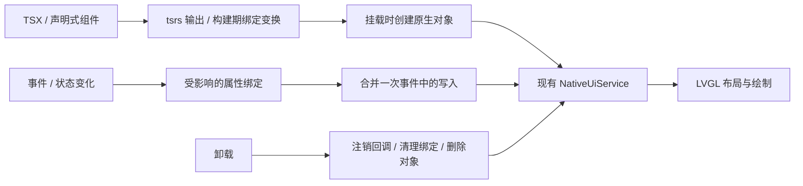

> 历史记录：路径、命令和包后缀对应拆分前的团子 OS 工作区。当前入口见 [EmbedTS 架构](../architecture.md)。

# TS LVGL 组件层可行性

状态：组件层设计提案。`@dango/sdk/ui` 已提供命令式句柄、`ui.build()` 声明式
构建与 `ui.batch()` 有界属性提交；尚未提供 JSX 组件运行时、React 兼容层或
细粒度状态系统。宿主协议与失败语义见[原生 UI 批次](native-ui-batches.md)。

## 执行模型

组件函数在挂载时创建 LVGL 对象，状态绑定记录需要更新的属性。状态变化仅调度
相关绑定，同一轮事件中的变更合并后通过现有 UI 宿主请求提交。LVGL 继续负责布局、
样式计算、绘制和对象树，JS 管理组件状态、绑定与清理。



tsrs 能输出 JSX/JavaScript，但 JSX 本身不会生成响应式更新、生命周期和 LVGL
对象管理。面向 LVGL 的绑定变换、组件运行时和 TSX 子集检查仍需单独实现。
当前 dango-ts 入口只接受 `.ts`，没有将 JSX/TSX 支持记作已有能力。

以下为候选 API 的伪代码：

```tsx
function Counter() {
  const [count, setCount] = createSignal(0);
  return (
    <Column gap={12}>
      <Label text={() => `点击了 ${count()} 次`} />
      <Button text="增加" onClick={() => setCount(count() + 1)} />
    </Column>
  );
}
```

`text` getter 明确声明动态绑定，其他属性在挂载时求值。初期仅依赖普通 JSX 工厂和
绑定运行时即可表达这种语义；自动识别表达式依赖的编译变换可另行评估。组件函数
执行一次的语义更接近 Solid，与 React 每次 render 重新执行函数的语义不同，因此
候选 API 不使用 `useState` 等会暗示 React Hooks 兼容性的名称。

## 方案成本

| 方案 | 每次状态变化的主要工作 | 适用范围 |
| --- | --- | --- |
| 当前 SDK 句柄与批次 | 应用显式选择更新项，合并提交 | 小型页面与直接控制 |
| 组件 + 属性绑定 | 调度受影响的绑定，更新变化的属性 | 设置、相册、状态面板等原生 UI |
| React 式虚拟树协调 | 组件重执行、新树分配、diff、原生属性提交 | 需要完整协调语义的场景，需额外预算 |

细粒度绑定可以保留函数组件、组合、声明式布局和事件属性的开发体验。静态节点
挂载后不重复创建，标量变化不重建父节点，列表按稳定 key 增删。显式批处理避免
同一轮状态变化重复发送属性请求。

成本来自初次组件/闭包/订阅分配、变更调度、JS 与 Rust 间的数据编码，以及原生
属性请求与布局。JSX 转换与主机打包耗时不进入设备更新路径。没有测量前不能给出
固定开销比例，也不能用 TS brain 的回调耗时估算 UI 组件层成本。

当前 dango-ts 仅允许工作区导出与相对模块，应用子集还禁止 `any`、类型断言、动态属性
修改和 re-export。直接安装 React 或 react-reconciler 不会成为可构建应用。组件包
需要定义自己的有类型宿主适配边界，并扩展 `.tsx` 入口与生成代码检查；应用层继续
遵守子集约束。

## 生命周期与边界

绑定和事件订阅随组件卸载注销。异步回调完成后需检查组件代次，已卸载组件不得
更新旧句柄。框架资源应接入现有应用停止与 UI 清理流程，使用相同的配额。
变化批次通过现有 UI 请求与 redraw boundary 提交。已实现的 `ui.build()` 将
父子节点、布局与事件放在一次请求中，`ui.batch()` 合并已有控件的标量更新。
宿主按已调度时间分片续跑，片间回到原有 UI 主循环；整个请求只返回一次最终结果。
延后发布与跨片执行期间保留中间树屏障。组件层可以直接等待该提交边界，无需根据
设备冷启动耗时自行重试已执行的命令。
宿主在执行前校验结构、局部引用和配额，执行失败时删除本批新建控件；既有属性
保留已执行的修改。因此组件层仍需定义状态恢复与过期异步结果的处理方式，
不能把一次批次提交当成具备属性回滚的事务。

高频传感器、动画和大像素图像继续交给原生服务或 framebuffer 路径。组件状态
不承担逐像素更新，也不要求所有页面按固定 JS 帧循环刷新。列表虚拟化、原生动画
和组件生命周期分别保留明确接口。

## 验证范围

原型先覆盖静态页面、单标签更新、小型 keyed 列表和反复挂载/卸载，以当前命令式
SDK 的相同页面作为基线。记录 JS 回调时间及分位数、分配次数/峰值、宿主请求数、
LVGL 对象增删、触摸到最终显示的延迟和退出后的资源回收。

主机确定性测试验证只更新目标属性、事件清理、keyed 列表身份和过期异步结果；
实体板用于验证交互延迟、原生布局成本和连续更新时的堆变化。通过这些测量后再
决定是否需要完整虚拟树协调、Hooks 兼容或并发调度。
