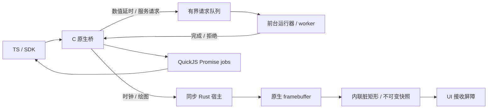

> 历史记录：路径、命令和包后缀对应拆分前的团子 OS 工作区。当前入口见 [EmbedTS 架构](../architecture.md)。

# TS 宿主路径优化与设备证据

TS 应用通过固定的 QuickJS-NG 执行 `.rsts` 字节码。高频宿主接口直接传递标量，
通用服务保留 JSON 与复制二进制接口。包的引擎指纹和 `HOST_ABI=3` 必须匹配固件；
不匹配的包在反序列化前拒绝，不执行旧格式转换或旧 ABI 加载。

## 执行路径

`crates/ts-engine/csrc/bridge.c` 根据结果类型直接创建 JS 值、Uint8Array 或 void。
数值延时不构造操作名、JSON 参数或成功结果，`system.sleep(0)` 仍经过运行器和 UI
提交检查。每个 VM 在初始化时申请有界等待槽位，完成请求后复用槽位并释放 JS 引用。
worker 轮询保留等待队列容量，活动 worker ID 使用固定数组。

`crates/os/src/apps/ts_scheduling.rs` 按累计工作时间决定继续、合作式让出、强制暂停
或真正等待。持续就绪工作仍受暂停策略约束；实际显示、UI 和存储屏障立即生效。
调度阈值在有界 VM 批次返回后检查，不能作为单个 intrinsic 或批次的硬抢占期限。
一个同步工作窗口共用频率投票；进入等待前结束该窗口。

`crates/os/src/apps/ts_graphics.rs` 只在快照独占且尺寸一致时复用像素存储，按脏矩形
复制行。保留旧快照的消费者不会观察到后续绘制。四项脏矩形直接内联复制，UI 从
发布快照借用 blit 视图，不建立临时矩形或 blit 列表。`present()` 的完成包含 UI 已
复制快照的屏障；面板传输与 UI 的刷新节奏仍会影响应用观察到的耗时。
快照缓存在显示租约期间占用一张 RGB565 图的空间，并计入原生图形预算；关闭显示
后释放。稳定复用减少大块申请与释放，常驻容量和 VM 的 JS 账本仍需分别观察。

## 构建选择

QuickJS C 使用 `-O2`。同板 `-O3` 对照没有取得稳定收益，且固件增加 85,152 B，
因此保留 `-O2`。这项对照使用相同的计算、让出次数、输入和校验值。

Rolldown 在字节码生成前压缩 AST，保留函数、类及属性名。压缩和未压缩的计算包
也在同一固件上执行。各用例收益不同，单纯缩短 JS 文本不计为设备运行时加速。
QuickJS vendor 文件继续匹配固定上游提交和逐文件摘要；本轮没有修改解释器内核。

## 计时与内存口径

六项配对计算及定向诊断入口见 [基准说明](../../tests/benchmarks/script-engines/README.md)。
样本采用设备单调毫秒时钟，包含应用请求的让出和正常后台负载。编译、上传、启动、
预热和样本输出位于正式计时区间之外。生产频率动态变化，未锁定温度或逐样本 MHz。

运行时分别记录 job、宿主分派、入队、完成、合作式让出、强制暂停和显示屏障耗时。
job 时间包含嵌套宿主回调，这些字段不能直接相加。`Promise.resolve()` 与宿主请求
的 Promise 生命周期不同，两个基准的差值不能等同于纯宿主时间。

VM 的 `used=0` 只证明其 backing allocator 账本回收。原生图形和服务队列分别统计；
物理碎片通过 SRAM/PSRAM 的空闲字节、最大连续块、块数及实际连续申请一起检查。
压力结果限定于记录的负载和生命周期，不能据此推断长期碎片情况或同时使用相机、
音频、网络和存储时的表现。TS 与 Lua 共用物理 PSRAM，没有独立的 VM 物理分区。

## 后续解释器热点

ESP32-S31 的当前目标为 `rv32imafc`，提供单精度浮点指令。JS `number` 的 double
运算仍调用软件辅助函数。QuickJS 的 int32 快速路径在乘法结果超出 int32 后转换为
double；随后的取模进入浮点路径。目标反汇编中可见 `__floatdidf`、`__muldf3`、
`__divdf3` 和 `fmod`，因此大整数数值计算不能靠移除宿主 JSON 获得全部剩余收益。

进一步改善通用数值执行需要研究解释器中的数值快速路径及字节码分派，保留精度、
负零、NaN 和取模规则。对象/数组访问和 Promise reaction/job 的创建、调度与回收
也是解释器内的候选热点。将 double 改为 float32、将整组计算移到 Rust，或减少基准
的让出次数都会改变被测语义或工作量，不能作为同一项通用 TS 解释器优化的对照。

显示提交的屏障耗时属于 UI/显示路径。复杂真实应用仍可能暴露新的服务序列化或
图像处理热点；本轮结果不构成所有宿主路径均已达到极限的证明。

## 2026-11-04 冻结候选

最终镜像为 5,654,992 B，SHA-256 为
`35c84923510631d55c499cfa95665b838278f036a82824b27830bc6a6d0b4ac1`。
OTA 记录为 slot 1 → 0，启动序号 141，设备完成自检并标记 `Valid`。符号检查确认
只包含 TS VM，不包含 Lua VM 或 TS 源码解析器；链接资源预算通过。

下表比较上一轮已测优化版本和最终版本，单位为 ms，均为 `device-quick` 五个正式
样本的中位数；算法、输入、工作单元和让出次数保持一致。

| 用例 | 上一轮 TS | 最终 TS | 速度比（上一轮 / 最终） |
| --- | ---: | ---: | ---: |
| integer | 176 | 68 | 2.59 |
| mandelbrot | 1,240 | 383 | 3.24 |
| primes | 622 | 207 | 3.00 |
| matrix | 544 | 266 | 2.05 |
| sort | 278 | 154 | 1.81 |
| objects | 286 | 197 | 1.45 |

定向诊断中，256 次 SDK 零延时中位数为 182 ms，上一轮为 1,148 ms；同一最终镜像
的 256 次标量绘图为 124 ms，JSON 绘图控制组为 527 ms。32 次局部帧提交为 564 ms，
整图申请/复制控制版本为 903 ms。发布基准累计 198 次有脏区域的提交只申请一张
460,800 B 快照，共复制 2,778,624 B；空脏区域不申请或复制像素。

计算运行的 `jobs_us/work_us` 约为 85%，该比例描述有界运行器观测，仍包含嵌套回调。
帧发布运行的 UI 接收屏障约占观测工作与屏障总时间的 76%。二者分别支持继续分析
解释器执行与 UI/显示节奏，不能合并为单一的“TS 执行耗时”。

最终镜像完成两组各八次生命周期压力：每次 256 轮字符串/对象更替，以及每次 64 帧
局部发布。每次 VM 关闭账本均为 `used=0`、`failures=0`，分别采样到 533,565 B 和
161,412 B 的引擎峰值。SRAM 最大连续块为 48,776 B；PSRAM 在图形缓冲释放后回到
12,710,824 B。检查点的 PSRAM 4 MiB 与 SRAM 4 KiB 连续申请全部成功。主机配对
TLSF 压力还覆盖 Lua 和 TS 的重复 VM 创建/销毁；本轮没有重新运行物理 Lua 对照。

主机 OS 回归为 365 项通过、2 项既有忽略；本轮引擎 29 项、编译器/打包 52 项、Lua
引擎 71 项及 Python 基准验证 11 项通过。设备完整能力探针和 2048、Dino、Flappy、
Snake、Photo 的启动/停止检查通过。最终 brain 为 TS、`error=0`；临时跑分应用已清理。
本轮未重新进行人工触摸、按键和振动验收。CST9220 的既有 Header 警告仍出现在日志中。

本地原始记录位于 `target/ts-fast-host-20261104/`：`final-results.json`、
`source-budget4-build.json`、`firmware-budget4.json` 与 `device-budget4/` 分别记录
汇总、203 个输入文件的摘要、固件身份和每项设备原始事件。
