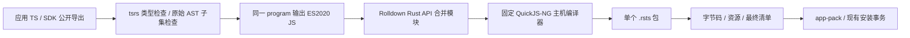

> 历史记录：路径、命令和包后缀对应拆分前的团子 OS 工作区。当前入口见 [EmbedTS 架构](../architecture.md)。

# TS 编译工具链与应用工作区

TypeScript 的开发入口集中于 `typescript/`，正式应用保留在 `apps/`。
主机编译工具为 Rust crate `ts-compiler`，命令为 `dango-ts`；运行时继续接受固定
QuickJS-NG 字节码格式 `.rsts`。一个固件只包含 Lua 或 TS 引擎。

## 编译流程与职责



`typescript/compiler/src/frontend.rs` 直接调用 [tsrs](https://github.com/oxc-project/tsrs)
Rust 库，使用原始源码的类型和 AST 执行规则，然后调用同一 program 的 emit。
`subset.rs` 管理运行时子集，`bundle.rs` 调用 Rolldown Rust API，最终输出一个
只有 `dango:host` 原生导入的 ES 模块。Rolldown 提供模块解析、合并和 tree shaking；
完整类型检查和依赖类型信息的规则由 tsrs 承担。

每次编译在独立线程执行，使用与上游 tsrs CLI 相同的递归栈余量。tsrs program、
checker、诊断和 AST 不跨越该线程的内存区域，返回前释放，外部只接收拥有所有权的
文本或字节。编译工具通过库接口供 OS 的主机构建脚本和集成测试使用。

`dango-ts check/build/app`、固件内置 TS brain 构建均不启动 Node.js。pnpm 用于
编辑器包链接和工作区开发命令，其 `dango-ts` 入口是调用 Cargo 的 shell 启动器。
`pnpm typecheck` 保留固定的上游 tsrs CLI，检查完整 SDK 和所有工作区源码。
原生编译器的运行与应用组装不依赖 npm 包安装。

| 组件 | 固定版本 / 来源 |
| --- | --- |
| tsrs Rust 库 | `v0.20.1`，Git 提交 `77d3cddb44540734abc33a42ccca4d3f33bee527` |
| TypeScript 语义 | `7.1.0-beta`，提交 `3e9236361fa97a9e6c685f4833ac457ae2d8c50a` |
| Rolldown | crates.io `1.2.16` |
| QuickJS-NG | `e22ce4de4362dc5fd4794cfa3c03fc7fdba5f015` |
| Rust | 根 `rust-toolchain.toml` 指定 `1.99.1` |
| pnpm 开发入口 | pnpm `12.14.0`、Node.js ≥`24.11.1` |

TS 7 工具链仍为预发布版本。tsrs Rust 库尚未发布到 crates.io，因此使用固定 Git
提交；根 `Cargo.lock` 锁定编译工具的 Rust 依赖。`pnpm-lock.yaml` 锁定可选工作区
开发入口的 npm 依赖，不再包含 Rolldown npm 或原 JS 检查器的依赖。

## 目录与导入

```text
package.json / pnpm-workspace.yaml / pnpm-lock.yaml
Cargo.toml / Cargo.lock
typescript/
  README.md
  compiler/                     ts-compiler / dango-ts
    src/                        Rust 检查、模块打包、应用组装与 CLI
    tests/                      检查器与命令行回归
  sdk/                          一个 @dango/sdk 包
    src/api/                    可信宿主接口适配
    src/helpers/                受限应用公共代码
  examples/
    hello/                      安装 ID ts-hello
    system-demo/                安装 ID ts-system-demo
  tsconfig.base.json
  tsconfig.json
apps/games/snake/
  README.md
  lua/                          Lua 清单、脚本、资源和许可证
  ts/                           TS 清单、脚本、资源、许可证和包配置
```

其他四个正式应用采用相同版本目录。两种实现保留相同应用 ID、安装路径
`/system/apps/<id>` 或 `/data/apps/<id>`，以及数据根 `/data/appdata/<id>`。
`lua/` 与 `ts/` 是源码组织层，设备安装路径不包含语言版本目录。
示例不进入正式应用集；其源码目录名也不必重复安装 ID。

```ts
import { sleep } from "@dango/sdk/system";
import * as ui from "@dango/sdk/ui";
import { Random } from "@dango/sdk/game";
```

一个 `@dango/sdk` 包同时提供接口和辅助功能。`src/api/` 参与完整类型检查，内部
JSON/二进制编解码属于可信宿主适配；`src/helpers/` 继续接受全部应用子集检查。
包合并不扩大可信代码范围。未来的 UI 封装可增加 SDK 公开子路径，无需新增顶层包。

pnpm 与 Rust 编译器读取同一份 `package.json` 导出表。包内相对模块可以使用
`./helper.js`，解析到 `helper.ts`；正式应用通过包名引用 SDK。
现有独立客户端的 `dango:*` 别名仍指向同一 API。任意 npm 应用依赖尚未开放。

## 构建与交付入口

```sh
cargo fetch --locked
cargo run -p ts-compiler --locked --offline -- check typescript/examples/hello/scripts/main.ts
cargo run -p ts-compiler --locked --offline -- app apps/games/snake/ts --out target/snake-ts
cargo run -p app-pack --locked --offline -- bundle target/snake-ts/snake target/snake-ts-bundle
```

可选 pnpm 开发入口：

```sh
pnpm install --frozen-lockfile --ignore-scripts
pnpm check
pnpm typecheck
pnpm check:apps
pnpm --filter @dango-apps/snake build
```

`build` 完成类型、规则、打包及字节码编译后才原子替换输出文件；失败保留旧包。
`app` 在临时目录组装整个应用，成功后整体发布到尚不存在的输出目录。
安装身份来自 launcher ID。输出含 `<id>/` 与 `build-report.json`，后者记录字节数
与 SHA-256。应用资源、许可证和来源记录随包交付，TS 源码、其他引擎脚本、包配置、
`node_modules` 和 `dist` 不进入 TS 载荷。

完整应用集合仍使用公共脚本：

```sh
python3 scripts/build_apps.py target/apps-ts --engine ts
python3 scripts/build_apps.py target/apps-lua --engine lua
cargo run -p app-pack --locked --offline -- check target/apps-ts
```

公共脚本枚举应用并调用 Rust 的单应用入口来构建 TS 载荷，Lua 载荷沿用原复制流程。
`app-pack check/system/bundles apps` 默认读取 Lua 版本。TS 源清单的 `.ts` 入口在
产物中改为 `.rsts`，由 app-pack 和既有安装事务继续交付。

## 验证记录

本次 Rust 工具链与目录迁移的检查证据存放在 `target/ts-toolchain-refactor/`：

- `compiler-tests.log`：44 项检查器回归及 2 项 CLI 回归；CLI 测试清空 PATH，验证
  编译和应用组装不依赖外部运行时，同时覆盖失败保留旧包、创建输出父目录和安装 ID。
- `pnpm-frozen.log`：移除旧依赖目录后按冻结锁文件重装；只安装上游 tsrs 开发 CLI。
- `typecheck.log`、`check-apps.log`：SDK、五个正式应用、两个示例的类型与子集检查。
- `checks.log`：完整仓库检查，包含主机原生 LVGL/LittleFS 集成、双引擎固件、资源
  预算和符号隔离。引擎与 ELF 来源另见 `target/engine-checks/evidence.json`。
- `results.json`：本次工具版本、产物指纹、应用布局与检查结果。

本次迁移没有刷写或运行设备。此前 tsrs Node API 版本生成的 SDK 探针与五个正式应用
在现有普通 TS 固件运行的证据保留于 `target/ts-parity/tsrs-migration-results.json`；
该记录不作为本次原生 Rust 工具链的实体验收。更早的触摸、按键、相册操作及 brain
事务记录见 [设备验证](ts-engine-device-validation.md)。

## 后续 UI 封装

[TS LVGL 组件提案](ts-lvgl-components.md) 仍处于设计阶段，尚未交付 JSX/TSX 或 React
运行时。优先采用保留 LVGL 对象、稳定句柄、事件驱动更新和批量属性提交的薄组件层。
构建期语法展开不必增加设备运行时，但树比较、对象分配和跨宿主调用会产生实际开销。
组件层应与直接 SDK 调用比较首帧、事件响应、更新耗时、峰值内存和长期启停回收，
再决定是否需要更完整的声明式树协调。
